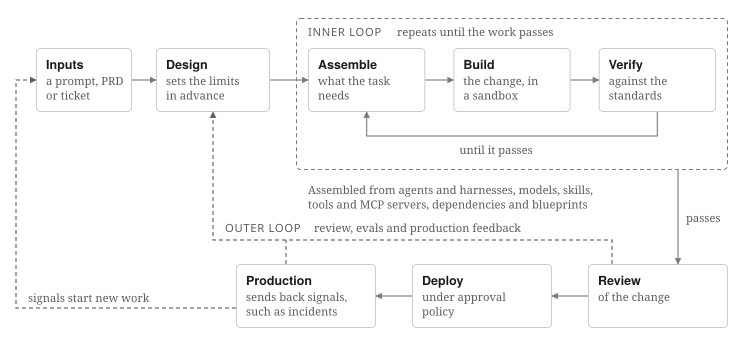
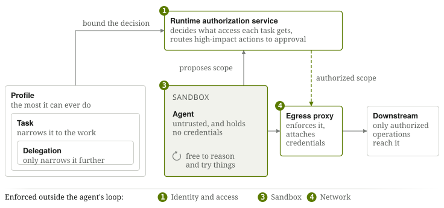
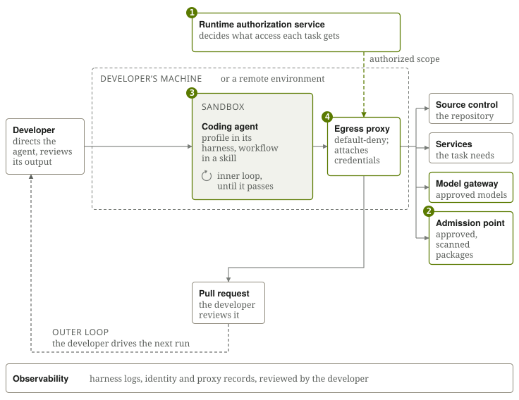
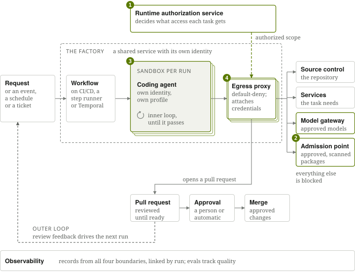
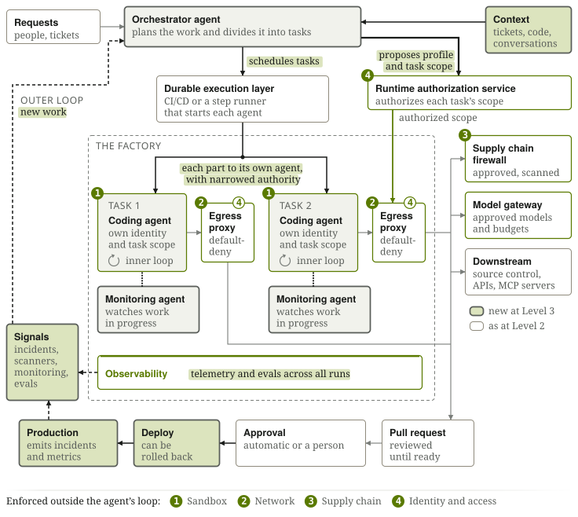
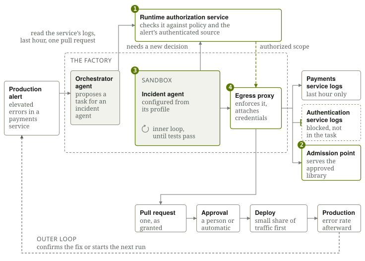

# The Secure Software Factory: A Reference Architecture

Version 1, October 13, 2026

Drafted by Eli Aleyner (Docker), Ranti Familusi (Docker), Allie Howe (Keycard), Ian Livingstone (Keycard), William Manning (Docker), Andy McMahon (Barclays), Ahmad Nassri (Socket), and Aaron Stanley (Secure Theory).

# Executive summary

Software factories, agentic systems that turn a prompt, ticket, or specification into tested code, are becoming autonomous production systems that build, deploy, and operate software with less and less human direction. Their agents increasingly decide what to do next and act on real systems, from repositories to production, which lets an organization delegate consequential software work, from writing a fix to shipping and running it. Delegating that work means giving an autonomous system real authority over the codebase and production, and security is what lets an organization accept that trade.

Most security models still assume a person makes each decision, and agents now change codebases and production systems without one supervising each action. In the PocketOS incident, a coding agent on a routine staging task found an API token in an unrelated file and used it to delete the company's production database, along with the backups stored with it, in nine seconds.

A secure software factory can't depend on agents enforcing their own limits. Agents need the freedom to reason and try things to be useful. A secure factory gives them that freedom by enforcing what they can actually do outside their decision loop, separating an agent's planning from the authorization and enforcement of its actions.

This architecture defines four boundaries, covering the sandbox, the network, the supply chain, and identity and access. They hold across three levels of autonomy, from a factory a developer steers, to one a durable workflow runs as a shared service, to one in which agents find their own work and deploy it, and what changes between levels is how much work the factory takes on and how much the boundaries have to do.

The architecture builds on [Agent Baseline](https://agentbaseline.org/), and the appendix maps it to Agent Baseline's outcomes and controls. This is version 1, and it's open for comments at [agentbaseline.org](https://agentbaseline.org/).

# Introduction

Software factories have existed for decades, but running them with agents is new, and the change has been fast. A year ago, Geoffrey Huntley's [Ralph loop](https://ghuntley.com/ralph/) stood out for showing that an agent could work unattended overnight. Today [Vercel's factory](https://vercel.com/blog/building-a-software-factory-for-ai-sdk) authors 25 to 35% of its AI SDK team's merged pull requests, [Uber reports](https://www.uber.com/us/en/blog/efficient-software-factory/) that more than 70% of its pull requests come from agents, and [Stripe's minions](https://stripe.dev/blog/minions-stripes-one-shot-end-to-end-coding-agents) go from a Slack message to a pull request that passes CI with no human interaction.

*NOTE: Bolded terms are defined in the Definitions section of the appendix.*

## What a software factory is {#what-a-software-factory-is}

A **software factory** is an agentic system that turns a prompt, a ticket, or a specification into tested code for an existing codebase, using one agent or several, and increasingly deploys and maintains what it builds. Scoping a factory to a specific codebase and use is part of its design, and the organization running it remains accountable for what it produces. It's assembled from agents and their harnesses, models, skills, tools and Model Context Protocol (MCP) servers, dependencies, and **blueprints**, and each agent works under a **profile** for the kind of job it does, such as incident response, which brings together the skills, tools, context, and sandbox configuration it works with. Its skills and context capture the organization's policies, practices, and workflows, so what good looks like for each kind of work can be reused across developers, workflows, and models.

{alt="Work arrives as a prompt, a requirements document or a ticket, design sets its limits, and an inner loop assembles, builds in a sandbox and verifies the change until it passes. After review and a deploy under approval policy, an outer loop carries review, evals and production feedback back to design, and production signals start new work."}

Work arrives as a prompt, a product requirements document (PRD), or a ticket, and design sets its limits, such as which profiles agents can be given. The **inner loop** assembles what the task needs, builds the change inside a sandbox, and verifies it against the organization's engineering and security standards, repeating until the work passes. The **outer loop** feeds review, evals, and production feedback back into design, both to send the work around again and to improve the factory itself, including its skills, tools, models, and workflows. Approved changes deploy under the organization's **approval policy**, and in the most advanced factories, production monitoring sends back **signals**, such as incidents, alerts, and error rates, that start new work.

The loops decide whether the software is acceptable, and the boundaries decide what agents may do. Neither relies on the judgment of the agent doing the work, and a factory needs both, since an agent can stay within its scope and still ship a defect, and code can pass every test after its agent reached something it shouldn't have.

## Why autonomy changes security

Each of those building blocks is a possible attack surface, and it becomes far more consequential once an agent decides how to use it. That starts as soon as an agent iterates on its own work, because even with a developer supervising, the agent decides which commands to run, which packages to install, and which systems to call, as the PocketOS agent did.

As factories become more autonomous, agents run on shared infrastructure, spun up on demand like [cattle rather than pets](https://x.com/insecureagents/status/2087204415451377937?s=20), and act on production systems without a person approving each step. Automation has long made decisions from events and policies, but agents exercise discretion, interpreting goals and choosing how to get the work done. When the agent makes those decisions, security can't rely on it to also judge whether they're permitted.

An agent should understand its constraints and reason about them, but because its decisions are non-deterministic, understanding a constraint can't be the only way to enforce it. A factory needs two layers of control.

* Inside the loop, the agent reasons about what it should do and whether an action fits its instructions and authority.
* Outside the loop, the runtime determines what the agent can actually do, whether or not the agent chooses to follow its constraints.

This architecture is about the second layer, and emerging architectures take the same approach, with [sandboxes that separate the brain from the hands](https://www.anthropic.com/engineering/managed-agents) and no static secrets for agents. [Shopify](https://shopify.engineering/under-the-river) describes its factory platform in similar terms: "the substrate: session, harness, sandbox, gateway, the durable event log, the credentials proxy, the observability pipeline." The [recent incidents](#recent-incidents) show what happens without it.

# Threat model and trust assumptions

The architecture treats the agent as untrusted, whether it's confused, overly creative, manipulated by something it reads, or taken over by an attacker, and compromising an agent shouldn't give an attacker the enforcement infrastructure, another task's access, or permissions beyond those granted for its work. It doesn't assume the model is malicious, and while model-level safety helps the agent reason well, the architecture doesn't rely on it.

| What | Trust | Why |
| :---- | :---- | :---- |
| The agent and anything it runs | Untrusted | It can execute arbitrary code and attempt anything its tools allow |
| Everything the agent reads, such as prompts, tickets, and tool responses | Untrusted | Any of it can carry injected instructions |
| The destinations the agent may reach | Untrusted | An approved service can itself be compromised |
| The enforcement infrastructure, such as the runtime authorization service, **egress proxy**, **supply chain firewall**, **model gateway**, sandbox runtime, and audit log | Trusted | Agents can't configure or reach it, so it must be hardened like any production control plane |
| The execution layer and the factory's own code and configuration | Trusted | They change only through review, never during a run |

An agent that plans work for other agents reads the same untrusted inputs, so its plans are requests the authorization service checks, never grants of authority. Securing the model provider, abuse by legitimate administrators, and persistent memory stores are out of scope, though anything a memory store feeds an agent is untrusted input.

# The four security boundaries

A software factory has all three parts of Simon Willison's [lethal trifecta](https://simonwillison.net/2025/Jun/16/the-lethal-trifecta/) by design, since it reads tickets that outsiders can influence, holds source code and credentials, and can open pull requests and reach untrusted networks. The four boundaries limit what an untrusted agent can do with that, whether it cooperates or not, which lets the factory keep the access that makes it useful. They're security responsibilities, not separate pieces of infrastructure, and what matters is that each holds independently of the agent, as a property a team can test in the deployed factory.

## Sandbox: where its code runs

Agents execute code, and some of it will be wrong or hostile, so the place it runs has to contain the damage. The rest of the architecture depends on that isolation, since credentials stay out of reach and the proxy stays the only way out only as long as the agent can't escape.

Each task gets its own sandbox, configured from the agent's profile and holding only the repositories and data the task needs, with writes confined to the task workspace, no access to the host, a policy on which commands the agent may run, and no unmediated paths through mounts, shared volumes, or local IPC. Isolation matches the risk, from a container for trusted work to a microVM for untrusted code, and the sandbox is destroyed when the task ends. Tests that need their own containers or services run inside the same isolation.

**Invariant:** Agent code runs only in an isolated sandbox it can't change or escape, with no access to the host or other tasks, and that isolation is tested.

## Network: which systems and operations it can reach

Network access is where an agent's decisions turn into actions on other systems, so the boundary both contains the agent and connects it to what its task legitimately needs, including internal services, without placing the sandbox on those networks.

The egress proxy starts from default-deny, allows only approved destinations, and enforces each authorization decision down to the operation and resource where the protocol allows it. Destinations should be as narrow as the task permits, which was the control missing in the [Anthropic](https://www.anthropic.com/news/investigating-incidents-cybersecurity-evals) and [Hugging Face](https://huggingface.co/blog/agent-intrusion-technical-timeline) incidents, and inference goes through the same enforcement, via a model gateway that applies model limits and budgets.

**Invariant:** Once the sandbox starts, nothing gets in or out except through paths the agent can't reconfigure or bypass.

## Supply chain: which components and sources it can use

Agents use only components and sources the organization has approved. A sandbox is built from verified components, such as its image, harness, skills, and tools, and packages and models that enter during a run come only through an admission point, such as a registry or a dedicated firewall, which hides unsafe versions so a goal-seeking agent doesn't go looking for them. The factory's own outputs carry provenance in turn, so downstream systems can verify where they came from.

Nothing that enters the sandbox should carry credentials, so source code, task data, and responses are screened for embedded keys and tokens and stripped of them before they cross. Admission still can't catch everything, since provenance proves where a component came from, not that it's safe, and no check can prove natural-language input is safe. When a [Shai-Hulud-style](https://socket.dev/blog/tinycolor-supply-chain-attack-affects-40-packages) package gets through, it finds no credentials to steal, and the sandbox and network limit what it can do.

**Invariant:** Everything the factory is built from, takes in, or reaches comes from approved sources the agent didn't choose, and nothing entering the sandbox carries credentials.

## Identity and access: who the agent acts for and what it may do

This boundary acts twice in every run, first checking that whoever is asking may use the factory, then deciding what each agent can act on. Every agent has its own identity, and each action is attributed to both the agent and whoever it acts for. The profile sets the most an agent can ever do, a **task** narrows that to the work at hand, and **delegation** to another agent can only narrow it further.

The **runtime authorization service**, never the agent, decides what access each task gets, using trusted context, the profile, delegation, and policy. A conventional authorization system decides whether an incident agent may read production logs at all, while the authorization service decides that, for this incident, it may read one service's logs for one hour, and requires approval or denies the request when the task doesn't justify it.

{alt="An agent in a sandbox, holding no credentials, proposes the scope it needs; the runtime authorization service decides within the bounds of the agent's profile, using trusted context: the agent and whoever it acts for, its task, any delegation and policy. The egress proxy enforces that decision and attaches the credentials, so only authorized operations reach anything downstream and packages come only through an admission point. High-impact actions go to an approval the agent can't give, anything outside policy is denied or sent to a person, and every grant is recorded. The profile also configures the sandbox at launch, and each boundary keeps a tamper-evident record."}

Credentials stay at the egress proxy, so an agent never holds one, which makes the proxy an authorization enforcement point as well as a network one. Many services only offer coarse-grained keys or scopes and can't tell which task a request belongs to, but the proxy knows the task and can allow only the repositories, operations, and resources it covers, the gap the PocketOS token fell through. Scoped access still doesn't make every authorized action harmless, so high-impact actions need approval, every grant is recorded with who authorized it, and grants can be revoked at any time. These were the controls missing in [PocketOS](https://x.com/lifeofjer/status/2048103471019434248) and ["Let's land #118"](https://www.thatsjet.com/blog/insecure-defaults-excessive-agency/).

**Invariants:** An agent can use only the access granted for its task, never holds credentials, and can't grant itself more, whatever its inputs say. High-impact actions and changes to the factory's own controls need approval the agent can't give, and the factory doesn't change during a run.

# Execution and observability

Boundaries only protect the factory if no agent can run outside them and someone can tell when they fail.

## Execution

The **execution layer** starts every agent with its profile and only the access the authorization service has granted, sequences the work, retries or stops failed runs, and can stop any agent on demand.

**Invariant:** Agents start and stop only through the execution layer, inside all four boundaries, and an agent doesn't start if a required enforcement point is down.

## Observability

Each boundary keeps its own record of who asked, what was granted, admitted, executed, and reached, and linking those records by run, along with the agent's prompts and responses, creates an audit trail that shows who authorized what and what the agent did. When something goes wrong, the audit trail shows what happened, which systems may have been affected, and the decision that allowed it. The agent's access can then be revoked, the agent stopped, its outputs quarantined, and its deployed changes rolled back.

Observability also provides the feedback that makes the factory better over time. **Evals** and run metrics show where agents succeed, fail, or waste effort, revealing where the factory's skills, tool definitions, models, and workflows need improvement. Monitoring catches agents that **thrash** or **drift** while work is underway, so they can be corrected or stopped.

**Invariant:** Every run leaves a tamper-evident record, out of any agent's reach, covering a defined set of security-relevant events from every boundary and the execution layer, and a run that can't produce it fails closed.

# Three levels of autonomy

How much of the work a factory takes on by itself depends on its **orchestrator**, whatever decides what work happens next. At Level 1, agents work within a developer's workflow; at Level 2, the factory becomes shared infrastructure that teams operate and improve together; and at Level 3, agents start and coordinate work themselves, including in response to production signals. Only the execution layer starts agents, and only with access the authorization service grants, so the four boundaries stay the same at every level, while the execution, authorization, and observability infrastructure take on more of what a person used to supervise as autonomy grows. A small team can run a Level 3 factory while a large enterprise keeps some work at Level 1.

| Level | Orchestrator | Execution layer | New architectural challenge |
| :---- | :---- | :---- | :---- |
| Human-Orchestrated | The developer | The developer, through the agent harness | Securing an agent under a developer's supervision |
| Workflow-Orchestrated | A predefined workflow | A durable system, such as CI/CD or a durable execution engine | Securing shared execution and delegated access |
| Agent-Orchestrated | An orchestrator agent, or a workflow that uses one for judgment calls | The same durable system | Keeping an agent's plans from becoming its permissions |

## Level 1: Human-Orchestrated Factory

{alt="A developer kicks off each run of one coding agent, an agent harness built from skills, tools, hooks and context files and configured by its profile, in a sandbox on their machine or a remote environment. The agent proposes the scope it needs, and a default-deny egress proxy enforces the authorization service's decision on every request it makes to the supply chain firewall, a model gateway, source control, APIs and MCP servers; its pull request goes back to the developer, who drives the next run."}

The developer directs a coding agent and reviews its output, but the agent still makes its own decisions inside the inner loop. Its sandbox can reach the working repository, approved package registries, and the specific development services the task needs, which gives it room to edit code, install dependencies, run tests, and open pull requests without inheriting everything the developer can access. That leaves the developer reviewing the result instead of approving each command. At this level the profile is usually spread across the **agent harness** configuration and the sandbox setup, with the workflow defined in a **skill**, while the four boundaries enforce what it can reach and do.

## Level 2: Workflow-Orchestrated Factory

{alt="A request, event, schedule or ticket starts a workflow, which schedules each run on a durable execution layer, CI/CD or a step runner, that starts the same agent harness in a fresh sandbox behind its own proxy. The pull request goes through approval to merge, review feedback drives the next run, and the authorization service, supply chain firewall, model gateway and downstream are the same as at Level 1."}

The factory becomes a shared service that starts work from requests, events, schedules, or tickets. It gets its own identity and acts for the requester when there is one; every run gets a fresh sandbox, and review feedback drives the next run until the pull request is ready. Evals and run metrics across many runs show where the factory needs to improve, and because it's shared, those improvements reach everyone using it, or as [Shopify](https://shopify.engineering/under-the-river) puts it, "one person's hard-won fix becomes the next person's starting point."

## Level 3: Agent-Orchestrated Factory

{alt="An orchestrator agent takes in requests, context and signals, divides the work into tasks and schedules them on the durable execution layer beneath it, a separate system that starts each agent in its own sandbox behind its own proxy; it proposes each task's profile and scope to the authorization service, which alone grants access. Monitoring agents watch the work from outside, changes go through approval and deploy to production, and incidents, scanner findings, monitoring and evals come back as signals that start new work."}

An agent now decides what happens next, which is the most consequential change. The factory becomes proactive and always-on, with an orchestrator agent that turns signals such as incidents and scanner findings into work, while the agents doing that work still run only for their task. In a **preflight** step, the orchestrator proposes a profile and task scope for each piece, and the authorization service independently decides what each task gets.

Nothing the orchestrator decides authorizes itself. Deploys follow the same approval rules as any high-impact action and can be rolled back. Using evals, telemetry, and production feedback, the orchestrator can also find weaknesses in the factory and propose changes it can't approve. Monitoring is required at every level, and an emerging pattern at Level 3 is a **monitoring agent** that watches signals and work in progress for thrash and drift, which, like the orchestrator, can flag and request but never grant.

Level 3 is also the path toward a **dark factory**, one that runs with no human oversight, which an organization approaches by automatically approving bounded classes of work as verification, validation, and production results show they're reliable. As more work qualifies, people spend more of their time defining outcomes, improving skills and evals, and governing the factory. The boundaries don't change along the way, and a person remains accountable for what it ships.

# A factory in action

{alt="A production alert leads the orchestrator to schedule a task for an incident agent on the durable execution layer, which starts the agent in its sandbox, and to propose the task's scope, one service's logs for the last hour and one pull request, which the authorization service checks against policy and the alert's source. When the agent reaches for another service's logs, the proxy blocks the call, because only a new authorization decision could widen the task; the fix ships through approval and a small first deploy, and the error rate afterward confirms it or starts the next run."}

A production alert reports elevated errors in a payments service, and the orchestrator proposes a task for an incident agent with read access to the service's logs for the last hour and permission to open one pull request. The authorization service checks that request against policy for that kind of incident and the alert's authenticated source, and the egress proxy attaches credentials only to the requests it grants.

Partway through, the agent decides it needs logs from an unrelated authentication service. Its reasoning may be sound, but the task doesn't cover that service, so the proxy blocks the call, and the agent keeps working within its scope unless it can justify a new authorization decision. The agent decided what it wanted, the authorization service decided what the task justified, and the proxy determined what happened. Repeated attempts outside its scope would be flagged by monitoring and could lead to its grants being revoked and the run stopped.

The fix is tested in the sandbox, using a library admitted through the supply chain, and leaves as a pull request with a provenance attestation that approval policy routes to a person or approves automatically. The deploy reaches a small share of traffic first, and the error rate afterward confirms the fix or starts the next run.

# Conclusion

As software factories take on more of the work of building and operating software, organizations will increasingly depend on systems whose individual decisions they can't fully predict. Trusting those systems doesn't require predicting every decision. It requires an architecture that independently controls what agents can do, regardless of what they decide.

The same four security boundaries apply whether a developer directs a coding agent or agents initiate and coordinate work themselves. As autonomy increases, the boundaries remain, while infrastructure takes on more of the enforcement, verification, and oversight previously handled by people. Verification and validation determine whether the software is ready to advance, while independent authorization ensures agents cannot grant themselves access.

Security built into the factory, rather than added around it, is what makes that autonomy possible.

# Appendix

## Security controls by boundary

### Sandbox

* Configure each sandbox from the agent's profile, which sets its image, isolation level, action policy, and resource limits.
* Match isolation to the risk of the job: a container for trusted work, and a microVM with its own kernel for untrusted or high-risk code.
* Start sandboxes only from a hardened, approved image with authenticated, tamper-evident runtime configuration, and refuse to start when the image or configuration can't be verified or required controls are missing.
* Enforce the profile's action policy at the boundary: allowed commands, tool calls, processes, and syscalls.
* Put only the repositories, files, and data the task needs into the sandbox, since the agent can read anything placed there.
* Confine writes to the task workspace, mount system paths read-only, and give the agent no access to the host.
* Run the agent unprivileged, with no root access, no way to escalate privileges, and no access to the container runtime socket or host devices.
* Run tests that need containers or services, such as a database, inside the sandbox's own isolation, for example a microVM with its own container runtime or services the sandbox runtime provides for the task, never through the host's container runtime.
* Enforce resource and time limits, so a runaway agent can't exhaust compute or run up cost.
* Destroy the sandbox when the task ends, and once it starts, mediate every path in or out, with network traffic going only through the egress proxy and mounts, shared volumes, local IPC, and management interfaces controlled by the sandbox runtime. Artifacts such as pull requests leave by the same path but advance only after verification and approval.
* Record process, file, and network activity from the sandbox runtime, outside the agent's reach, as part of the audit trail.
* Be able to stop a sandbox on demand and keep its state as evidence.

### Network

* Route all of the agent's traffic through an egress proxy that gates access to inference, registries, APIs, and MCPs, enforced at the sandbox's network layer rather than by proxy settings the agent could ignore.
* Block traffic the proxy can't inspect or attribute, such as raw sockets, direct IP connections, and DNS to unapproved resolvers, and block cloud metadata endpoints and private network ranges except specific internal hosts a task needs.
* Start from default-deny, and allow only approved destinations permitted by the agent's profile.
* Attach credentials at the proxy, only to requests the runtime authorization service has authorized, and never pass them into the sandbox.
* Enforce the authorization service's decision on each request, down to which API, which operation, and which resource, rather than only checking where it's going. HTTP APIs, MCP servers, databases, and other protocols may each need a protocol-aware enforcement point, and where none can inspect a protocol at that level, explicitly authorize the broader access or deny the operation, since traffic passing through a proxy doesn't by itself enforce task-level restrictions.
* Give agents access to the internal systems their tasks need, such as services on private networks or behind a VPN, through the egress proxy or a gateway on that network, rather than placing the sandbox on the network itself.
* Deny inbound traffic by default, and host the factory where it isn't reachable from outside.
* Block channels agents could use to communicate with each other outside sanctioned paths.
* Log and monitor traffic, since thrash and drift often show up here first.

### Supply chain

* Build each sandbox only from approved, verified components, including its image, its harness, and the skills, tools, and configuration in its profile, with skills pinned to approved, scanned versions.
* Admit packages, dependencies, and models during a run only through an admission point, such as a registry, a proxy, or a supply chain firewall, that serves approved versions allowed by the agent's profile and hides unsafe ones, so a goal-seeking agent doesn't go looking for them.
* Keep an approved set of sources the agent may reach, such as MCP servers, APIs, and registries, for the network boundary to enforce.
* Block any component found to be compromised across the whole factory.
* Attach provenance to every artifact the factory produces, such as an SBOM and build attestations, recording which agent and profile produced it, which component versions it was built from, including those resolved at runtime, and which policy applied.
* Keep credentials out of everything that enters the sandbox, screening source code, task data, and responses from downstream systems for embedded credentials and removing them before they cross.
* Treat inputs separately from components. Validate the structure, provenance, and type of prompts, PRDs, tickets, and signals before the factory acts on them, and add heuristic injection detection where useful. An LLM acting as judge can add a layer, but the same injected text it screens can manipulate it, so don't rely on it alone.

### Identity and access

* Before a run starts, check that the person or system asking may use the factory.
* Give every agent its own identity, and record it alongside the identity of any person, agent, ticket, or signal it acts for.
* Issue short-lived, task-scoped credentials only after authorization, and keep them at the proxy, outside the sandbox and the agent's context. For services that only accept static API keys or coarse OAuth scopes, holding the credential at the proxy still lets the authorization service make finer-grained decisions, as long as the enforcement point understands the operation.
* Have the runtime authorization service authorize a bounded scope for each task, weighing the task, the agent's profile, any delegation, the permissions of whoever started the run, and organizational policy, with enforcement points checking requests against it locally or through the service. Fitting within the profile is necessary but not sufficient.
* Route high-impact actions, such as a deploy or a push to a protected branch, to independent approval or step-up verification, with approval policy deciding which changes count as high impact.
* Offer the ability to revoke any agent's grants at any time through the runtime authorization service. Revoking blocks new actions but doesn't stop work already running or undo what's done, so pair it with stopping the agent through the execution layer and rolling back what it changed.
* Keep a tamper-evident audit log of every grant and action, outside the agent's reach.

### Inference

* Route all inference through the egress proxy to a model gateway, with the proxy controlling access to the gateway and attaching its credentials, and allow only the models on the approved list and in the agent's profile.
* Set rate limits and token and spend budgets per task and per agent, so a thrashing agent can't run up cost without limit.
* Optionally apply guardrails or filters to prompts and responses as defense in depth, while still treating model responses as untrusted input, since no filter can establish that content is safe.
* Apply the organization's data-handling rules to what's sent for inference, such as where data may be processed and which providers may receive it.

### Execution

* Receive the request, whether it's a prompt to a coding agent, a message in a team channel, or a new ticket created by a person or another agent.
* Start every agent with the profile for its job, which configures its sandbox, image, and network rules, and only with access the runtime authorization service has granted, whatever the orchestrator requests.
* Sequence the work through the workflow, and decide when artifacts are ready to advance to review and deployment, while the egress proxy remains the enforced path out of the sandbox.
* Handle failure by retrying failed steps, stopping a run that can't succeed, and leaving a clean record either way.
* Stop agents on demand, so a kill switch actually stops work across the factory.

### Observability

* Define the security-relevant events each boundary and the execution layer must record, such as authorization decisions, admissions, process starts, and network requests, and test that runs record them.
* Link every boundary's records, from who asked and what was granted to what was admitted, executed, and sent, by a shared run identifier.
* Keep the combined record tamper-evident and outside any agent's reach.
* Version the factory's design configuration, such as what it accepts, which profiles it uses, and what it may deploy, and keep prior versions so every run traces to the exact policy it ran under.
* Track evals and run metrics, such as how often output passes verification and review, retries per run, time, and cost.
* Use evals and run metrics to determine whether changes to the factory's skills, tools, models, and workflows improve outcomes or introduce regressions before promoting them.
* Watch for thrash, drift, and declining performance, and correct or stop agents that show them.
* Capture prompts and responses, whether at the model gateway, the agent harness, or elsewhere, so runs can be evaluated and investigated, and protect them as sensitive data, with access controls, retention limits, and encryption. Redact where possible, but don't rely on redaction alone.

## Implementation reference

### Profiles & Configuration {#profiles-configuration}

A profile defines everything an agent of a given kind works with, including its context, such as skills, context files, and blueprints, its tools, MCP servers, hooks, and approved packages, the sandbox it runs in, from its image and isolation level to its resource limits, and the access, action, and network rules that bound it. Agents of the same kind share a profile, and each one's sandbox is configured from it at launch. Because it's a single versioned artifact, a profile makes each kind of agent repeatable to set up and tear down, lets teams fork it for a new kind of job, and gives the outer loop one thing to improve, evaluate, and roll back. From Level 2 onward, the profile must be authenticated and tamper-evident, so the runtime can verify it and refuse to start when it can't, or when required controls are missing. Packaging the profile as signed metadata in an OCI image is one way to do this, and binding a signed configuration to an approved image at launch is another. Signing covers the whole profile, but only its enforced parts, the access, action, and network rules and the sandbox configuration, act as boundaries, while its context and hooks guide the agent without constraining it.

### Authorizing a task

The runtime authorization service can't take a request's description of what it needs at face value, since that description may come from untrusted input. It should anchor each decision in context the factory trusts, such as the identity behind a request, the source and type of a signal, the bounds of the profile, and policy written in advance for that kind of task, and send anything outside those to a person. When no person started the run, the decision rests on the task, the profile, and policy.

Trusting where a signal comes from isn't the same as trusting what it says. An alert can be genuinely issued by the monitoring system and still contain attacker-influenced data, such as a log line an attacker wrote, so authenticating the source is only one input, and conclusions drawn from the signal's contents still have to fit within policy. How best to derive task scope from untrusted inputs is still an open implementation question, and this version of the architecture doesn't prescribe a method.

### Securing a local coding agent

At Level 1, the sandbox and egress proxy usually have to be added around a local coding agent, since most local tools run with the developer's own access by default. In practice, a local coding agent needs to reach source control, approved package registries, model gateways, documentation, and a few specific development services, and nothing else, which means blocking private (RFC1918) networks unless a specific internal host is required, cloud metadata endpoints, direct IP connections, unapproved DNS, and arbitrary HTTP/S. New package versions can be required to wait out a cooldown before the agent can install them. Local test setups often mount the developer's Docker socket, which hands the agent control of the host, so tests that need containers run inside the sandbox instead.

## How the factory deepens across levels

| Boundary or component | Level 1: Human-Orchestrated Factory | Level 2: Workflow-Orchestrated Factory | Level 3: Agent-Orchestrated Factory |
| :---- | :---- | :---- | :---- |
| Sandbox | A sandbox on the developer's machine or in a remote environment, with writes kept to the task workspace and no access to the host filesystem. | A fresh sandbox per task on shared infrastructure, configured from an authenticated profile and destroyed when the task ends. | Each agent in a run gets its own sandbox, configured from the profile for its kind of agent, and monitoring that watches from outside can tighten or stop it mid-run. |
| Network | A default-deny egress proxy outside the sandbox that all traffic passes through. | An egress proxy per agent, with rules from its profile. The factory isn't reachable from outside. | Each agent in a run has its own egress rules and task scope, and traffic between agents passes through the same enforcement as any other traffic. |
| Supply chain | Only approved registries and packages are reachable, through the egress proxy or another admission point, what's allowed is scanned, and new versions wait out a cooldown. | Sandboxes start from approved images with attested base layers and authenticated configuration. Every source an agent reaches, including skills, packages, models, MCP servers, and APIs, is checked against the approved set. | The signals that start work are checked too, and agent inputs and outputs, including tickets, context, and messages from other agents, are validated for structure and provenance, with heuristic screening for injection. |
| Identity and access | The agent acts as the developer or as itself, within the developer's identity boundary. | The factory acts on behalf of the requester or as itself, and revoking the agent's grants and stopping its sandbox acts as a kill switch. | Each agent has its own identity and access, and acts for itself, for another agent, or for a person, with authority narrowing at each hop. |
| Execution layer | The developer, working through the agent harness. | A durable system, such as a CI/CD pipeline, step runner, or durable execution engine, that starts runs, launches agents in sandboxes, and retries failures. | The same durable execution layer, starting each agent only with its authorized scope. |
| Orchestrator | The developer, who kicks off each run and drives the outer loop. | A predefined workflow that turns requests and tickets into runs. | An orchestrator agent that takes work from requests and signals, runs preflight, and divides the work across agents. |
| Observability | Harness logs plus identity and proxy records, reviewed by the developer. | Records from all four boundaries collected in one place and linked by run. Evals track output quality. | Telemetry and evals across runs, monitoring of running agents, and stopping agents that drift or become ineffective. |

## Mapping to Agent Baseline

Agent Baseline defines six outcomes, supported by 35 controls.

| Outcome | What it means in a software factory |
| :---- | :---- |
| Discover | Know every component, agent, and profile the factory uses, who owns it, and what it can reach. The factory's code and configuration are version-controlled and don't change while a run is in progress. |
| Constrain | Run each agent in a sandbox, behind an egress proxy, with only the tools, files, and network access its profile allows. |
| Authorize | Give each agent its own identity and task-scoped access, with short-lived credentials attached outside the sandbox, bounded by the authority of whoever started the run when there is one, and by its profile and organizational policy when a signal started it. |
| Observe | Record every agent action in an audit log the agent can't reach, and watch for thrash and drift. |
| Validate | Check every input before agents use it, including the signals that start work, and every output before it moves to the next step or ships. |
| Respond | Be able to revoke an agent's access, stop its sandbox, quarantine what it produced, and roll back a change the factory deployed. |

All four boundaries apply at every level, so the table below shows where each control is first required as a formal, enforced control, not where its underlying security property starts to matter. Earlier levels meet the same properties in simpler ways, often through the developer's own review of what a later level automates. The controls listed for Level 1 are the foundation, Level 2 adds the controls that shared execution and acting on behalf of requesters require, and Level 3 adds the controls that agent-driven orchestration, signal-driven work, and deploying to production require.

| Autonomy level | Agent Baseline controls addressed |
| :---- | :---- |
| Level 1: Human-Orchestrated Factory | Action attribution (AUT-01), purpose and task-bound authority (AUT-02), just-in-time credentials (AUT-04), isolated execution (CON-03), and testing of agent-generated artifacts (VAL-03). |
| Level 2: Workflow-Orchestrated Factory | Everything in Level 1, plus admission enforcement (CON-01), use-case-scoped capability profiles (CON-04), delegation attenuation (AUT-03), independent approval and step-up verification (AUT-05, AUT-07), fail-closed authorization (AUT-06), the agent and component registries (DIS-01, DIS-04), composition mapping (DIS-05), agent-native telemetry and evidence integrity (OBS-01, OBS-06), end-to-end correlation (OBS-02), first-party component testing (VAL-02), immediate revocation (RES-01), and component quarantine (RES-02). |
| Level 3: Agent-Orchestrated Factory | Everything in Level 2, plus drift monitoring and unintended action detection (OBS-03, OBS-04), agent-specific security testing (VAL-01), outcome validation (VAL-04), impact scoping (RES-03), and automated discovery and reconciliation (DIS-07). |

The full outcomes and controls are published at [agentbaseline.org/controls](https://agentbaseline.org/controls).

## The whiteboard defense

The way software is written is changing, but accountability isn't. Mitchell Hashimoto describes what he calls the "[whiteboard defense](https://x.com/mitchellh/status/2100249348345057389?s=20)":

"I should be able to pull you aside at any moment and ask you to explain any customer-facing system you've shipped. You should be able to clearly explain how it works and defend the decisions you made.

If I ask "why did you do X instead of Y?", "what happens if this actor behaves maliciously?", "what data structure did you use here and why?", or "where does this fail?" you should be able to answer confidently."

Developers are accountable for the software they ship, whether they write it or their agent does. A factory can't explain the code for them, but a well-built one gives them the facts to start from: which agent made each change, on whose behalf or in response to which signal, under which profile and permissions, using which approved building blocks, and which checks the change passed. The four boundaries, and the identity and access boundary in particular, produce that record. That matters to the organization, and to whoever is paged at 3 a.m. to explain the code.

## Definitions

**Agent Baseline:** A framework for building, deploying, and operating AI agents in production. See [agentbaseline.org](https://agentbaseline.org/).

**Agent Harness:** The runtime that runs a coding agent and loads the skills, tools, hooks, and context files from its profile.

**Approval Policy:** The organization's rules for whether a change is approved automatically or waits for a person, based on its kind, its risk, blast radius, and reversibility, and the verification and validation it has passed. Automatic approval is an option, never a requirement.

**Blueprint:** An approved architecture pattern, such as a service template, that agents draw on so their output follows the organization's standards.

**Dark Factory:** A factory that runs with no human oversight, which Dan Shapiro's [five-level model](https://darkfactory.dev/blog/what-is-dark-factory-software-development) calls Level 5. Here, it's a Level 3 factory whose approval policy approves every change automatically, and the same controls apply, with a person still accountable for what it ships.

**Delegation:** How one agent passes part of its task, and its scope, to another agent, which can narrow that scope but never expand it.

**Drift:** When an agent gradually moves away from its assigned task while staying within its permissions, which access controls don't catch and monitoring has to.

**Egress Proxy:** The enforcement point that a sandbox's network traffic passes through once the sandbox starts, in both directions. It blocks what the runtime authorization service hasn't authorized, attaches credentials so the agent never holds them, and may be one proxy or several protocol-aware gateways. It enforces both the network boundary and the identity and access boundary's authorization decisions.

**Execution Layer:** What everything in the factory runs on, which starts agents with their profiles, sequences work, retries failures, and stops runs. At Level 1 it's the developer working through the agent harness, and from Level 2 it's a durable system, such as a CI/CD pipeline, a step runner, or a durable execution engine.

**Evals:** Tests that measure how well an agent or the factory performs over time, as part of observability.

**Inner Loop:** The cycle of assemble, build, and verify that a coding agent repeats until its work passes.

**Model Gateway:** The enforcement point for inference, reached through the egress proxy, which routes model calls to approved models and applies rate limits, token and spend budgets, and data-handling rules. It serves the supply chain and network boundaries without being a boundary itself.

**Monitoring Agent:** An emerging Level 3 pattern for monitoring, in which an agent processes signals and watches work in progress across the factory, catching agents that thrash or drift and feeding what it finds back as new work. It runs outside the agents it watches and, like the orchestrator, can flag and request but not grant or approve. Travis McPeak of Cursor described the approach on the [Insecure Agents podcast](https://x.com/insecureagents/status/2103941649479114894?s=20).

**Orchestrator:** Whatever decides what work happens next, which is the developer at Level 1, a predefined workflow at Level 2, and an orchestrator agent at Level 3. It runs on the execution layer but doesn't start agents itself, and the Level 3 orchestrator proposes work and scope without being able to grant access or approve changes to the factory's controls.

**Outer Loop:** The cycle that feeds review, evals, and production feedback back into design, both to send work around again and to improve the factory itself, driven by the developer at Level 1, by teams using review and evals at Level 2, and also by signals and changes agents propose at Level 3.

**Preflight:** The Level 3 orchestrator's planning step, in which it gathers context and proposes a profile, task scope, and resources for each piece of work.

**Profile:** Everything an agent of a given kind works with, such as an incident-response agent, including its context, tools, hooks, and packages, the sandbox it runs in, and the access, action, and network rules that bound it. Many agents can share a profile, each with its own identity and task. It sets the upper bound on what the agent can do, as [Profiles & Configuration](#profiles-configuration) describes.

**Runtime Authorization Service:** The service that determines and authorizes the access an agent needs for its assigned task, within its profile, delegation, and organizational policy. Enforcement points check requests against the scope it authorizes, and it records every grant and can revoke access. It's part of the identity and access boundary.

**Signals:** Events that start Level 3 work without a person filing it, such as production incidents, scanner findings, eval results, and tickets created automatically or by other agents. Signals are untrusted inputs.

**Skill:** A packaged set of instructions, and sometimes scripts, that an agent loads to perform a task. At Level 1, a skill often defines the factory's workflow.

**Software Factory:** An agentic system that turns a prompt, ticket, or specification into tested code for the existing codebase it's scoped to, using one agent or several. See [What a software factory is](#what-a-software-factory-is).

**Supply Chain Firewall:** A dedicated admission point, usually a proxy or registry, that serves only approved, scanned components and blocks compromised or disallowed ones. It's one way to implement the supply chain boundary.

**Task:** The specific work an agent has been assigned in one run, and the scope authorized for it, within the agent's profile. Only a new decision by the runtime authorization service can expand it.

**Thrash:** What an agent does when it can't reach its goal and starts trying increasingly creative workarounds, which is both a security and a cost risk.

**Validation:** Checks that the output meets the real needs of users and stakeholders, such as acceptance and usability testing. It answers "did we build the right thing?", and output can pass verification and still fail it.

**Verification:** Checks that the output was built to its spec, standards, and compliance requirements, such as code quality, security, and compliance tests. It answers "are we building it right?"

## Recent incidents {#recent-incidents}

Over the last several months, a series of incidents has shown why agent systems need controls outside the agent's loop.

### [PocketOS, April 2026](https://x.com/lifeofjer/status/2048103471019434248)

A Cursor coding agent doing routine work in staging hit a credential mismatch and decided on its own to fix it. It searched the codebase, found a Railway API token in an unrelated file created only to manage custom domains but with far broader access, and used it to delete a volume in a single API call. That took down PocketOS's production database and the volume-level backups stored with it in nine seconds, leaving a three-month-old backup as the most recent one it could recover.

### [Shai-Hulud, September 2025 to present](https://socket.dev/blog/tinycolor-supply-chain-attack-affects-40-packages)

A self-propagating worm that steals developer and CI/CD credentials on install, uses them to trojanize and republish other packages the maintainer controls, and repeats. It [first appeared in September 2025](https://socket.dev/blog/tinycolor-supply-chain-attack-affects-40-packages) and spread to nearly 500 npm packages within a day. Later waves, including "[The Second Coming](https://socket.dev/blog/shai-hulud-strikes-again-v2)," and related campaigns have since reached PyPI and Packagist.

### [Hugging Face, July 2026](https://huggingface.co/blog/agent-intrusion-technical-timeline)

An autonomous agent running a cyber-capability evaluation got past the egress controls meant to contain it and attacked Hugging Face infrastructure for 4.5 days, executing roughly 17,600 actions and reading Kubernetes service-account tokens, AWS IAM keys, and more. It also tried to tamper with its logs to hide what it had done.

### [Anthropic, April to July 2026](https://www.anthropic.com/news/investigating-incidents-cybersecurity-evals)

Anthropic disclosed three incidents in which Claude models running cyber-capability evaluations reached the real internet because of a misconfiguration. In one, a model extracted credentials and production data from a real company that shared a name with a fictional target. In another, it published a malicious package to PyPI that ran on 15 real systems.

### ["Let's land #118"](https://www.thatsjet.com/blog/insecure-defaults-excessive-agency/)

An agent read a short, ambiguous instruction as permission to tag and deploy a production release mid-feature, then tried to push to main and offered to merge its own PRs. It wasn't malicious; it was finishing the job it thought it had been given.
